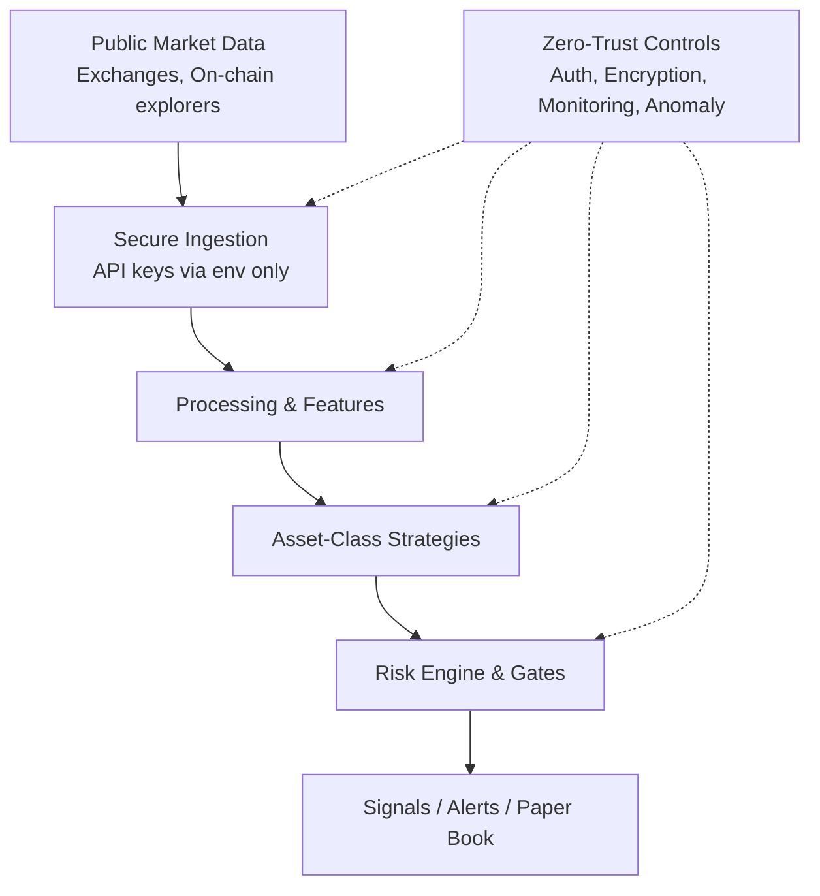

# AIxTech Crypto Trading Information System v9

> Paper-only automated cryptocurrency trading information system with multi-factor adaptive strategies per asset class, zero-trust cyber/data security architecture, and AI-agent harness. Research and educational purposes only. Builds on prior versions and the [zeekiankok92/aixtech-agent-harness-demo](https://github.com/zeekiankok92/aixtech-agent-harness-demo).

[](https://www.python.org/) 

## Disclaimer
This repository is for **educational, research, and paper-trading simulation only**. It does **not** execute live orders, manage real funds, or provide financial advice. Cryptocurrency trading involves substantial risk of loss. Always conduct your own due diligence.

No real API keys, private keys, or production personal data should ever be committed.

## Overview
Modular framework for building secure, auditable automated crypto trading **information systems**:

- Asset-class-specific trading strategies (majors, large alts, DeFi, stables, high-vol)
- Secure data ingestion and feature engineering (public APIs only in examples)
- Risk management, position sizing, and signal generation
- Zero-trust cyber and data security architecture
- AI coding agent harness with CI gates, disclosure trails, and human review (inspired by zeekiankok92)

## Key Enhancements in v9
- Strengthened zero-trust model with explicit least-privilege modules
- Multi-factor strategies combining trend, momentum, volume, on-chain signals (stubs), and volatility regimes
- Expanded asset-class coverage with adaptive parameters
- Improved secret scanning, PDPA-style data guards, and audit logging stubs
- Clear paper-only boundaries and risk gates

## Architecture
See [docs/architecture.md](docs/architecture.md) and [docs/security-architecture.md](docs/security-architecture.md).



## Quick Start
```bash
python3 -m venv .venv && source .venv/bin/activate
pip install -r requirements.txt
python -m crypto_trading demo
```

## Asset Class Strategies
| Asset Class | Examples | Primary Focus | Risk Level |
|-------------|------------------|----------------------------|------------|
| Majors | BTC, ETH | Trend + mean reversion + funding | Medium |
| Large Alts | SOL, BNB, ADA, AVAX | Momentum + volume + relative strength | Medium-High |
| DeFi | UNI, AAVE, LINK, MKR | Yield signals + volatility + TVL proxies | High |
| Stables | USDT, USDC, DAI | Peg stability, basis, yield arb signals | Low |
| High Vol | Memes, new listings | Strict size limits, time stops, vol filters | Very High |

Detailed in [docs/trading-strategies.md](docs/trading-strategies.md).

## Security
- Zero-trust: assume breach, least privilege, continuous verification
- Secrets only via environment / secret managers (never in code or logs)
- Audit logging, anomaly detection stubs
- See [SECURITY.md](SECURITY.md) and [docs/security-architecture.md](docs/security-architecture.md)

## AI Agent Harness
Follows principles from zeekiankok92: AGENTS.md rules, CI gates, human review, disclosure trail. See [AGENTS.md](AGENTS.md).

## Licence
[MIT](LICENSE)
